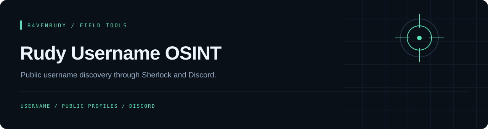

<p align="center"></p>

<p align="center">
  
  
  <a href="LICENSE"></a>
</p>

<p align="center"><strong>Public username discovery through Sherlock and Discord.</strong></p>

<p align="center"><a href="#overview">Overview</a> · <a href="#capabilities">Capabilities</a> · <a href="#quick-start">Quick start</a> · <a href="#implementation-notes">Implementation notes</a></p>

---

## Overview

A Discord wrapper around Sherlock. The `/username` command runs Sherlock against a configured list of 25 platform names, parses candidate profile links from its output and displays up to 20 matches in an embed.

## Capabilities

| Layer | Implemented behavior |
| :--- | :--- |
| Search | Invokes Sherlock as an asynchronous subprocess with selected `--site` values |
| Input | Checks username length and applies a basic character check |
| Results | Parses Sherlock stdout for platform names and public URLs |
| Discord | `/username` with an optional overall timeout parameter |

## Quick start

Requires Python, a Discord bot application and a Sherlock installation accessible to the bot process. Keep the bundled `raven.png`; it must be a readable image of at least 1 KB.

```bash
git clone https://github.com/r4venrudy/rudy-username-osint.git
cd rudy-username-osint
python -m pip install discord.py Pillow sherlock-project
sherlock --version
```

Set the `TOKEN` placeholder at the bottom of `bot.py` in your local copy. Do not commit your configured token. Enable Message Content Intent in the Discord developer settings because the current client requests it, and invite the bot with `bot` and `applications.commands` scopes.

```bash
python bot.py
```

Use `/username username:example_user timeout:60` in Discord.

## Implementation notes

- Sherlock's site identifiers and output format can change. The configured platform names must match the installed Sherlock version.
- A matching username is a lead, not proof that profiles belong to the same person. Findings need verification in context.
- Input validation is basic; the implementation is not a complete allowlist validator. The subprocess is passed an argument list rather than a shell command.
- The command uses a 10-second Sherlock per-request timeout and a separate overall wait. Timeout cleanup and concurrent command limits need review before operating a busy bot.
- No platform sign-in, private-profile access or identity attribution is implemented. Replies are channel-visible.

## Project map

```text
bot.py      Discord command, Sherlock runner and output parser
raven.png   Required startup asset
LICENSE     MIT license
```

## License

[MIT](LICENSE). Preserve the attribution in the license file.

---

<p align="center">Part of the <a href="https://github.com/r4venrudy">r4venrudy</a> project collection.</p>
